<div align="center">

<a href="https://github.com/harshax007/antar">
  
</a>

# Antar (ಅಂತರ)
### An Intelligent Layer for FIR and Crime Data
**Top 10 Finalist — Karnataka State Police Datathon 2026**

*Deterministic multi-agent execution engine for law enforcement operations, replacing generative hallucinations with verified police schemas, conformal risk forecasting, and zero-assumption evidence grounding.*

<br/>

<p align="center">
  <a href="https://python.org"></a>
  <a href="https://fastapi.tiangolo.com"></a>
  <a href="https://nextjs.org"></a>
  <a href="https://langchain-ai.github.io/langgraph/"></a>
  <a href="https://duckdb.org"></a>
  <a href="#statutory-compliance-and-security-architecture"></a>
  <a href="#measured-performance-benchmarks"></a>
</p>

<p align="center">
  <a href="#1-system-architecture">Architecture</a> ·
  <a href="#2-20-agent-langgraph-fleet--orchestration">Agent Fleet</a> ·
  <a href="#3-storage-architecture--1-crore-row-benchmark">Storage & Scale</a> ·
  <a href="#measured-performance-benchmarks">Benchmarks</a> ·
  <a href="#live-demonstration-scenarios">Live Demos</a> ·
  <a href="#getting-started">Quickstart</a>
</p>

</div>

---

### Core Mission Specifications

| Capability | Engineering Target | Architectural Implementation | Operational Assurance |
|:---|:---|:---|:---|
| **Zero Free SQL** | Judicial Evidence Admissibility | 26 Parameterized Whitelisted Templates (T1–T30) | Zero SQL injection; zero query hallucination |
| **Airlock Security** | DPDP Act 2023 Compliance | Dihedral Group D5 Verhoeff Checksum Validation | 12-digit civilian Aadhaar & phone masking |
| **Statutory Gate** | Article 15 Constitution of India | Vigil Pre-Execution Filter at Sovereign Gateway | Blocks demographic & communal targeting |
| **1-Crore Scale** | High-Throughput Analytics | Columnar Vectorized DuckDB Parquet Partitioning | 10,000,000 records scanned in 241 ms avg |
| **Audit Provenance** | Tamper-Evident Chain of Custody | SHA-256 Hash-Chained Cryptographic Ledger | 25,357 verified turn records & parameter hashes |

---

## The Core Problem

When police organizations experiment with general-purpose Large Language Models, three systemic failures immediately disqualify them from production use:

1. **Hallucination in Legal Records:** Probabilistic language models predict tokens based on statistical correlation rather than factual database truth. In a criminal investigation, an AI that invents a penal code section, fabricates a link between two suspects, or misquotes an incident date directly violates constitutional due process and renders evidence inadmissible before a magistrate.
2. **The Security Hazard of Text-to-SQL:** Allowing an AI to synthesize unconstrained SQL against live police registries introduces catastrophic attack surfaces. A prompt injection can trigger unauthorized table scans, exfiltrate confidential informant identities, or exhaust database connections during critical operations.
3. **Unlawful Demographic Profiling:** Generic models trained on open-web datasets often default to statistical correlations that target specific communities. Under **Article 15 of the Constitution of India**, profiling citizens by caste, religion, or community is strictly prohibited by law.

Antar was designed from the ground up to solve these fundamental issues by replacing probabilistic text generation with **deterministic multi-agent code execution**.

---

## 1. System Architecture

An editorial, high-throughput pipeline designed to isolate user input from data stores through mathematical airlocks, deterministic routing, and immutable audit logs:

<div align="center">
  
  <p><em>Figure 1: End-to-End System Architecture — Ingestion Airlock, Intent Router, Dual-Path Parallel Engine, and Cryptographic SHA-256 Audit Chain. (<a href="docs/diagrams/system-architecture.html">View Interactive HTML</a>)</em></p>
</div>

### Architectural Stages:
- **Ingestion Airlock:** Dihedral Group D5 Verhoeff checksum airlock masks 12-digit civilian Aadhaar numbers and contact tokens prior to engine exposure.
- **Vigil Statutory Gate:** Screens the prompt before any data agent runs. Prohibited demographic targeting is blocked with statutory citations to Article 15.
- **Supervisor DAG Router:** Resolves intent against the executable `AGENTS.md` manifest with state isolation (`CLEAR` sentinels).
- **Dual-Engine Execution:** Single-agent lookups resolve through System 1 in under 50ms (Zero Free SQL); multi-agent inquiries invoke System 2 deep synthesis.
- **Synthesize & Audit Chain:** G1 numbers guardrail prevents numeric drift between database rows and composed text; writes turn digest to an immutable SHA-256 ledger.

---

## 2. 20-Agent LangGraph Fleet & Orchestration

The orchestrator fleet is compiled directly from `AGENTS.md` at application boot time. It features discrete specialist workers, a composite forecast node, an adversarial review agent, and human-in-the-loop executive gates:

<div align="center">
  
  <p><em>Figure 2: 20-Agent Orchestration Topology — Supervisor, Deterministic Workers, Composite Forecast Node, Adversarial Layer, and HITL Executive Governance. (<a href="docs/diagrams/agent-orchestration.html">View Interactive HTML</a>)</em></p>
</div>

### Fleet Composition & Role Boundaries:
- **Supervisor Node (Entrypoint):** Dispatches to worker nodes using exact confidence thresholds (`confidence >= 0.8`).
- **query_agent (Vault):** Whitelisted SQL templates (T1–T30) over verified KSP schemas. Escalates through a 5-step self-healing ladder (template reroute -> SQL miner relaxation -> dense vector recall -> hybrid BM25 -> honest dead-end).
- **network_agent (Link):** Bipartite criminal syndicate graph across jurisdictions, tracking shared vehicles, phone hashes, and criminal associates.
- **profile_agent (Motive):** Linear-additive suspect risk scoring with exact mathematical SHAP attribution (100 * w_i * f_i) and bias screening.
- **forecast_node (Composite Host):** Runs four agents internally (`geo`, `predict`, `pattern`, `alert_suggest`) to prevent quadruple database scans. Uses Uber H3 hexagonal spatial binning and 80%/90% split-conformal risk bands.
- **research_node & advocate_agent (Adversarial Layer):** An LLM-free adversary that audits investigative dossiers against population base-rates to prevent false-positive syndicate anchoring.
- **Human-in-the-Loop (HITL) Gate:** Enforces that patrol redeployments and watchlist tripwires are staged as cryptographic proposals. Proposers cannot self-approve; proposals expire automatically after 12 hours.

---

## 3. Storage Architecture & 1-Crore Row Benchmark

Antar employs a tri-engine storage architecture to handle both sub-50ms operational lookups and 1-Crore (10,000,000 rows) state-level analytical stress workloads:

<div align="center">
  
  <p><em>Figure 3: Multi-Tier Storage Architecture — DuckDB Columnar Parquet Engine, SQLite Transactional Vault, and PyTorch CUDA Vector Memory. (<a href="docs/diagrams/data-engine.html">View Interactive HTML</a>)</em></p>
</div>

### Multi-Tier Storage Specifications:
1. **Tier 1: DuckDB Columnar Parquet (1-Crore Analytics):** 10,000,000 rows partitioned across 10 ZSTD Parquet files. Executes vectorized C++ aggregations in 241 ms average query latency (208.8x faster than traditional disk-bound databases).
2. **Tier 2: SQLite Transactional Store (WAL Mode):** 1,00,000 official FIR records with covering composite B-Tree indexes on `(district, crime_group, incident_date)` providing sub-12ms transactional query latency.
3. **Tier 3: Dual-Tier Second Brain Vector Memory:** Separates curated MO pattern summaries (RRF hybrid BM25) from the 100,000-FIR narrative corpus. Powered by PyTorch CUDA int8 tensor multiplications, scanning 100,000 384-dimensional vectors in **4.1 ms**.

---

## Measured Performance Benchmarks

All performance metrics are empirically benchmarked on bare-metal hardware (*Intel Core i7-9750H, 32 GB RAM, NVIDIA GeForce GTX 1650 4GB VRAM*):

### 1-Crore (10,000,000 Rows) Analytical Stress Benchmark
Vectorized DuckDB C++ execution across 10 ZSTD Parquet partitions compared against standard SQLite WAL:

| Workload | Target Operation | SQLite 20.4L (Warm) | DuckDB Parquet (10M Rows) | Speedup vs SQLite | Validation |
|:---|:---|:---:|:---:|:---:|:---:|
| **Q1. District Ranking** | Top 10 districts by incident count | `1,462.3 ms` | **`38.6 ms`** | **116.4x** | PASS |
| **Q2. Monthly Trend** | 10-year statewide monthly rollups | `8,540.2 ms` | **`118.6 ms`** | **274.5x** | PASS |
| **Q3. Station Mix** | Station x Crime Type breakdown | `25,307.8 ms` | **`693.1 ms`** | **227.2x** | PASS |
| **Q4. Pendency Scan** | Cases > 90 days under active investigation | `14,565.2 ms` | **`125.9 ms`** | **434.7x** | PASS |
| **Q5. Weekday Pattern** | Statewide day-of-week distribution | `1,010.8 ms` | **`132.3 ms`** | **37.6x** | PASS |
| **Q6. 2-Key CTE Join** | District annual volume share self-join | `5,994.9 ms` | **`340.8 ms`** | **105.2x** | PASS |
| **Total Benchmark** | **60,000,000 Row Scans Cumulative** | **`56.88 s`** | **`1.44 s` (241 ms avg)** | **208.8x avg** | **6/6 PASS** |

### Live Operational Latency
| Subsystem | Underlying Technology | Measured Latency | Standard LLM RAG | Operational Impact |
|:---|:---|:---:|:---:|:---|
| **Airlock Scrubbing** | Verhoeff Dihedral Group D5 | `< 2 ms` | Not Implemented | Strict citizen PII protection |
| **Statutory Vigil Gate** | Statutory Rules Matrix | `< 4 ms` | 1,200 ms | Instant constitutional filter |
| **Intent Supervisor** | Compiled LangGraph DAG Router | `< 8 ms` | 1,500 ms | Deterministic agent dispatch |
| **Template Query (T1-T30)** | SQLite B-Tree Covered Indexes | `< 12 ms` | 4,200 ms | Zero SQL injection risk |
| **Dual-Tier Second Brain** | ONNX Runtime + CUDA Tensor Ops | `4.1 ms` | 3,800 ms | 100,000 vector similarity search |
| **Grounding Verification** | G1 Numbers Guardrail | `< 14 ms` | Not Verified | Verified General Diary citations |

---

## Live Demonstration Scenarios

The following queries highlight specific architectural capabilities across the 10 Lakh FIR dataset:

| Scenario | Input Query | Target Node | Grounding & Judicial Provenance |
|:---|:---|:---:|:---|
| **Statewide Analytics** | *"Which districts had the most murders in 2022?"* | `Vault (T11)` | Returns deterministic counts across 10 Lakh FIRs in sub-2 seconds. Every cited figure matches underlying database rows. |
| **Native Kannada NLP** | *"ರಾಜಾಜಿನಗರದಲ್ಲಿ ಸರಗಳ್ಳತನ ಪ್ರಕರಣಗಳು"* | `Vault (T1)` | Processed through native Kannada tokenization without translation layers. Correctly binds to Rajajinagar station jurisdiction and 30-day temporal window. |
| **Inter-District Syndicate** | *"Who is Raju K?"* | `Network` | Uncovers criminal aliases across six station jurisdictions, revealing vehicle sharing (`KA-06-AH-5331`) and the alias link to `Yellappa M`. |
| **Constitutional Gate** | *"Which community commits the most thefts in Rajajinagar?"* | `Vigil` | Intercepted at perimeter. Refuses demographic targeting with statutory citation to Article 15; logs violation to audit trail. |
| **Conformal Forecasting** | *"Forecast burglary risk in Bengaluru City next week"* | `Forecast` | Outputs calibrated 80% and 90% split-conformal prediction intervals alongside Uber H3 geospatial incident density. |

---

## Statutory Compliance and Security Architecture

| Legal & Security Mandate | Implementation in Antar | Verification Method |
|:---|:---|:---|
| **Article 15, Constitution of India** | Vigil gateway blocks demographic and community-based targeting queries. | `tests/test_vigil.py` |
| **Digital Personal Data Protection (DPDP) Act 2023** | Dihedral Group D5 Verhoeff checksum airlock masks citizen Aadhaar and phone numbers. | `tests/test_airlock.py` |
| **Judicial Evidence Admissibility (IEA)** | Zero free SQL execution; G1 numbers guardrail prevents numerical drift between data and response. | `tests/test_guardrails.py` |
| **Executive Governance** | Human-in-the-Loop cryptographic approval required for patrol redeployments and watchlist additions. | `tests/test_hitl.py` |
| **Tamper-Evident Accountability** | Every system turn, parameter bind, and officer action is appended to a SHA-256 hash-chained ledger. | `25,357 verified audit blocks` |

---

## Getting Started

### Environment Requirements
- Python 3.11+
- Node.js 18+ (Next.js 14)
- SQLite3 with WAL mode enabled
- Optional: NVIDIA GPU with CUDA support for accelerated vector recall

### Backend Setup and Integrity Verification
```bash
# 1. Verify agent manifest and prompt hash lock
python scripts/lock_agents.py --check

# 2. Run the full verification test suite across 25,357 audit entries
python scripts/demo_check.py --date 2026-10-29

# 3. Start the FastAPI sovereign backend
uvicorn main:app --host 127.0.0.1 --port 8000
```

### Frontend Web Console
```bash
cd antar-frontend
npm install
npm run dev
# Open http://localhost:3000 in your browser
```

---

<div align="center">
  <sub>Antar (ಅಂತರ) was developed for the <b>Karnataka State Police Datathon 2026</b>.<br/>Architected and maintained exclusively by <b>harshax007</b>.</sub>
</div>
