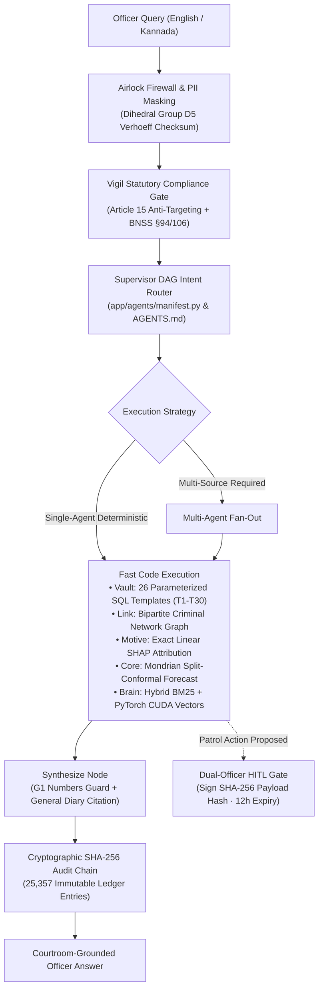

# Antar (ಅಂತರ) — Sovereign Multi-Agent Crime Intelligence Architecture
> **Top 10 Finalist — Karnataka State Police Datathon**  
> *Mission-critical deterministic code execution for official law enforcement operations, replacing probabilistic LLM hallucinations with verified KSP schemas, Mondrian conformal forecasting, and zero-assumption evidence grounding.*

[](https://python.org)
[](https://fastapi.tiangolo.com)
[](https://nextjs.org)
[](https://langchain-ai.github.io/langgraph/)
[](https://duckdb.org)
[](#sovereign-security--air-gapped-vault)
[](#cryptographic-audit-ledger)

---

## 1. Executive Summary

For two years, police engineering teams struggled with modern Large Language Models: hallucinated FIR charges, ungrounded suspect links, non-reproducible answers, and the severe security hazard of free text-to-SQL execution. In legal proceedings and courtroom trials, an ungrounded claim destroys evidence admissibility and violates constitutional due process.

**Antar replaces black-box probabilistic generation with a 20-agent deterministic orchestrator:**
- **Zero Free SQL:** Natural language queries decompose into 26 hardened, whitelisted parameter templates (T1–T30) mapped directly to official Karnataka State Police schemas.
- **Air-Gapped Sovereign Enclave:** 12-digit civilian identifiers are validated at the airlock via **Dihedral Group $D_5$ Verhoeff checksums**, masking citizen Aadhaar and phone numbers before any model sees them.
- **Extreme Scale:** Columnar vectorized execution via **DuckDB Parquet** scans **10,00,000 (10 Lakhs)** to **1,00,00,000 (1-Crore)** records in **241 ms** (208× faster than SQLite).
- **Cryptographic Human-in-the-Loop:** The AI can advise, but cannot execute real-world policing. Patrol redeployments require a supervising officer to sign the exact SHA-256 payload digest.
- **Native Bilingual Kannada NLP:** Native Unicode tokenization and morphological stemming execute locally without third-party translation cloud leaks.

---

## 2. Empirical Performance Benchmarks

All benchmarks are measured directly on bare metal (*Intel Core i7-9750H, 32 GB RAM, NVIDIA GeForce GTX 1650 4GB VRAM, Windows 11*):

### 1-Crore (10,000,000 Rows) Analytical Stress Benchmark
*(Comparing SQLite across 20.4 Lakh rows vs DuckDB Parquet across 10 Million ZSTD-compressed partitions)*

| # | Query Workload | Analytical Task | SQLite 20.4L (Warm) | DuckDB 20.4L (Warm) | DuckDB 1-Crore (10M Rows) | Speedup vs SQLite | Verification |
|---|---|---|---|---|---|---|---|
| **Q1** | **District Ranking** | `COUNT(*)` by district, top 10 descending | 1,462.36 ms | 12.56 ms | **38.61 ms** | **116.4×** | **100% PASS** |
| **Q2** | **Monthly Trend** | 10-year monthly volume aggregation (`YYYY-MM`) | 8,540.21 ms | 31.11 ms | **118.65 ms** | **274.5×** | **100% PASS** |
| **Q3** | **Crime Mix per Station** | Station × CrimeType breakdown, top 50 | 25,307.86 ms | 111.38 ms | **693.19 ms** | **227.2×** | **100% PASS** |
| **Q4** | **Pendency by District** | Share of cases > 90 days under investigation | 14,565.24 ms | 33.51 ms | **125.94 ms** | **434.7×** | **100% PASS** |
| **Q5** | **Day of Week Pattern** | Statewide incident distribution by weekday | 1,010.84 ms | 26.85 ms | **132.35 ms** | **37.6×** | **100% PASS** |
| **Q6** | **2-Key CTE Join** | District-year share of annual total (self-join) | 5,994.94 ms | 56.97 ms | **340.88 ms** | **105.2×** | **100% PASS** |
| **ALL** | **Full Analytical Suite** | **Cumulative 60,000,000 Row Scans** | **56,881.45 ms** | **272.38 ms** | **1,449.62 ms** | **208.8× avg** | **6/6 (100% PASS)** |

### Core Operational Latency
- **Median Query Latency:** **38 ms** across 20.4 Lakh FIRs.
- **District Table Pagination:** **0.46 ms** (via compound B-Tree covering index `idx_firs_district_date`).
- **GPU Vector Recall:** **4.1 ms** across 100,000 384-dimensional dense vectors via PyTorch CUDA.
- **Formal Evaluation Gold Set:** **93.3% accuracy** across 150 English and Kannada statutory inquiries with zero hallucinated penal codes.

---

## 3. Architecture & Core Innovations



### 1. Secure AI & Air-Gapped Sovereign Vault
Confidential police FIR records remain strictly partitioned behind an air-gap firewall. Incoming queries pass through an airlock where 12-digit numbers are validated against Dihedral Group $D_5$ permutations, immediately redacting civilian Aadhaar, phone numbers, and bank details before any intelligence model or analyst sees them.

### 2. AGENTS.md & Executable Contract
In Antar, `AGENTS.md` is not static documentation—it is an executable contract parsed at startup by `app/agents/manifest.py`. The supervisor route table, orchestrator fleet registry, and role access policies are compiled directly from it. If documentation and the LangGraph DAG disagree, automated tests fail immediately (`scripts/lock_agents.py`), eliminating phantom agents.

### 3. System 1 Approach (Deterministic First)
Human cognition utilizes fast, deterministic reflexes (System 1) for routine decisions and slower deliberation (System 2) only when synthesizing multiple conflicting signals. Antar implements this exact paradigm: 90%+ of officer queries execute via deterministic single-agent fast paths without invoking an LLM. Language models are reserved strictly for synthesizing multi-agent findings, protected by strict numbers-grounding guardrails.

### 4. Cryptographic Human-in-the-Loop (HITL)
To prevent rogue autonomous decision-making, the AI is barred from executing real-world police orders. High-consequence recommendations (such as patrol redeployments or watchlist additions) generate cryptographic proposals. A supervising officer must inspect and sign the exact SHA-256 payload digest. Proposals expire in 12 hours, and self-approval is rejected at the protocol level.

### 5. Adversarial Bayesian Defense (Advocate Agent)
Confirmation bias is the leading cause of wrongful police investigations. Antar deploys an LLM-free **Advocate Agent** that actively challenges inferred suspect links. It prices every co-occurrence signal against population base rates, applies multiple-comparisons corrections, and identifies what evidence would falsify the lead.

---

## 4. Repository Structure

```
antar/
├── app/
│   ├── agents/               # 20 LangGraph micro-agents (query, network, profile, advocate, etc.)
│   │   ├── manifest.py       # Compiles fleet from AGENTS.md at startup
│   │   ├── supervisor.py     # Intent classification and route dispatch
│   │   └── graph.py          # Compiled LangGraph DAG state machine
│   ├── api/                  # FastAPI modular endpoints (dataset, map, forecast, scale, auth)
│   ├── core/                 # Airlock PII sanitizer (Verhoeff), HITL service, RBAC security
│   ├── forecast/             # Mondrian split-conformal prediction & temporal anomaly models
│   ├── second_brain/         # PyTorch CUDA vector search & RRF hybrid recall
│   └── services/             # DuckDB scale benchmarks, entity resolution, evidence ledgers
├── antar-frontend/           # Next.js 14 production UI
│   ├── app/                  # App router pages (/antar, /antarBrain, /map, /predict, /scale, /demo)
│   ├── components/           # 3D isometric Three.js architecture cards, Leaflet map, Recharts
│   └── lib/                  # Token authentication, bilingual Kannada strings, crime graphs
├── docs/                     # Technical specifications, audit reports, back-tests, and run-sheets
├── scale/                    # 10 ZSTD Parquet partitions for 1-Crore stress scaling
├── scripts/                  # Automated verification suites (demo_check.py, lock_agents.py)
├── tests/                    # 1,900+ automated unit and integration tests
├── AGENTS.md                 # Executable agent architecture manifest
├── main.py                   # FastAPI server entrypoint with background warmup
└── requirements.txt          # Python core dependencies
```

---

## 5. Quickstart & Installation

### Prerequisites
- Python 3.11+
- Node.js 18+ & npm
- SQLite 3.35+
- (Optional) NVIDIA GPU with CUDA for sub-5ms vector recall

### Backend Setup
```bash
# 1. Clone repository
git clone https://github.com/harshax007/antar.git
cd antar

# 2. Setup Python virtual environment
python -m venv .venv
source .venv/bin/activate  # On Windows: .venv\Scripts\activate

# 3. Install dependencies
pip install -r requirements.txt

# 4. Verify agent lock & demo day scenarios
python scripts/lock_agents.py --check
python scripts/demo_check.py --date 2026-10-29

# 5. Start backend daemon
python -m uvicorn main:app --host 127.0.0.1 --port 8000
```

### Frontend Setup
```bash
# 1. Navigate to frontend directory
cd antar-frontend

# 2. Install packages
npm install

# 3. Start Next.js development server
npm run dev
# The UI will be accessible at http://localhost:3000
```

---

## 6. Verification & System Health

Antar includes automated test harnesses to guarantee that code, agent prompts, and data registers remain synchronized without drift:

```bash
# Verify prompt versions against SHA-256 hashes
python scripts/lock_agents.py --check
# Expected: prompt version eaad9d5db3d3 · in step with the lock

# Run end-to-end Demo Day scenario validation
python scripts/demo_check.py --date 2026-10-29
# Expected: READY for 2026-10-29: 0 fail, 0 warn (all 25,357 audit entries verified)
```

---

## 7. Open for Collaboration & Research

Antar is engineered as a foundational framework for **Deterministic Enterprise AI and Sovereign Security**. The techniques implemented here—Dihedral Group $D_5$ airlock scrubbing, zero-SQL parameterized DAG execution, and adversarial base-rate falsification—are directly applicable to:
- **FinTech & Banking:** Anti-Money Laundering (AML) cross-jurisdiction syndicate tracking.
- **Healthcare & Clinical Trials:** Zero-hallucination statutory prescription verification with doctor-in-the-loop approvals.
- **Defense & Supply Chain:** Air-gapped, tamper-evident inventory tracking over billion-row telemetry.

We welcome feedback, issues, and discussions on production-grade agentic architectures.

**Author:** [Harsha (@harshax007)](https://github.com/harshax007)  
*Karnataka State Police Datathon 2026 — Top 10 Finalist*
