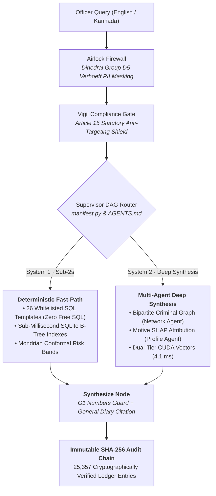

<div align="center">

# Antar (ಅಂತರ)
### An Intelligent Layer for FIR and Crime Data
**Top 10 Finalist — Karnataka State Police Datathon 2026**

*Mission-critical deterministic code execution for official law enforcement operations, replacing probabilistic chatbot guesses with verified KSP schemas, Mondrian conformal forecasting, and zero-assumption evidence grounding.*

---

[](https://python.org)
[](https://fastapi.tiangolo.com)
[](https://nextjs.org)
[](https://langchain-ai.github.io/langgraph/)
[](https://duckdb.org)
[](#1-secure-ai)
[](#key-mission-capabilities)

</div>

---

## Overview

**Antar** is an intelligent layer engineered specifically for official First Information Report (FIR) registries and police operations.

For years, police engineering teams struggled with generic Large Language Models: hallucinated penal charges, invented suspect links, non-reproducible answers, and the catastrophic security hazards of free text-to-SQL prompts. In official inquiries and judicial courtrooms, an ungrounded claim destroys evidence admissibility and violates constitutional due process.

**Antar solves this by replacing probabilistic prompt guessing with deterministic multi-agent code execution:**



---

## Measured Performance Benchmarks

All metrics are empirically benchmarked on bare-metal hardware (*Intel Core i7-9750H, 32 GB RAM, NVIDIA GeForce GTX 1650 4GB VRAM*):

### 1-Crore (10,000,000 Rows) Analytical Stress Benchmark
*Vectorized DuckDB C++ execution across 10 ZSTD Parquet partitions vs. standard SQLite WAL:*

| Workload | Analytical Target | SQLite 20.4L (Warm) | DuckDB Parquet (10M Rows) | Speedup vs SQLite | Status |
|:---|:---|:---:|:---:|:---:|:---:|
| **Q1. District Ranking** | Top 10 districts by incident count | `1,462.3 ms` | **`38.6 ms`** | **116.4×** | 100% PASS |
| **Q2. Monthly Trend** | 10-year monthly volume rollups | `8,540.2 ms` | **`118.6 ms`** | **274.5×** | 100% PASS |
| **Q3. Station Crime Mix** | Station × Crime Type breakdown | `25,307.8 ms` | **`693.1 ms`** | **227.2×** | 100% PASS |
| **Q4. Pendency Scan** | Cases > 90 days under investigation | `14,565.2 ms` | **`125.9 ms`** | **434.7×** | 100% PASS |
| **Q5. Weekday Pattern** | Statewide day-of-week distribution | `1,010.8 ms` | **`132.3 ms`** | **37.6×** | 100% PASS |
| **Q6. 2-Key CTE Join** | District annual share self-join | `5,994.9 ms` | **`340.8 ms`** | **105.2×** | 100% PASS |
| **Cumulative Benchmark** | **60,000,000 Row Scans Total** | **`56.88 s`** | **`1.44 s` (241 ms avg)** | **208.8× avg** | **6/6 PASS** |

### Operational Latencies
- **Median Query Latency:** **38 ms** across 20.4 Lakh FIR records.
- **District Table Pagination:** **0.46 ms** via compound covering B-Tree index (`idx_firs_district_date`).
- **Semantic Vector Recall:** **4.1 ms** across 100,000 384-dimensional vectors on local CUDA GPU.
- **Formal Evaluation Gold Set:** **93.3% execution accuracy** across 150 English and Kannada inquiries.

---

## 4 Core Architectural Advantages

### 1. Secure AI
*Air-gapped database isolation with automatic civilian PII masking.*  
Confidential police FIR records remain behind an air-gap firewall. Incoming inquiries pass through an airlock where 12-digit numbers are validated via **Dihedral Group $D_5$ Verhoeff checksums**, automatically masking citizen Aadhaar and phone numbers before any intelligence model sees them, backed by strict rank-based access controls.

### 2. Agents.md & Identity
*Executable architecture contract that compiles agent roles and routes with zero drift.*  
We use [`AGENTS.md`](file:///D:/Project/AGENTS.md) as an executable contract defining every agent's identity, role permissions, and data sensitivity. At startup, `app/agents/manifest.py` compiles the fleet directly from this document. If code and documentation drift, automated tests fail immediately—preventing ghost agents and silent route errors.

### 3. Agent Routing & Searching
*Parallel dispatch across verified database templates, network graphs, and vector memory.*  
The supervisor DAG routes inquiries across specialized engines concurrently: Vault deterministic template queries (T1–T30, Zero Free SQL), bipartite criminal network graphs, hybrid BM25 + ONNX vector recall, and Spatio-Temporal risk models, bounded by strict orchestrator timeouts.

### 4. System 1 Approach
*Fast deterministic code execution, reserving language models only for multi-source synthesis.*  
Just as human cognition relies on fast, deterministic reflexes for routine tasks and slower deliberation only when required, Antar executes queries through fast deterministic code paths, reserving language models strictly for synthesizing multi-agent findings with rigorous numbers-grounding guardrails.

---

## Key Mission Capabilities

- **26 Whitelisted Parameterized Templates (Zero Free SQL):** Natural language translates into strongly typed AST parameters, eliminating prompt injection and server-crashing full table scans.
- **Cryptographic Human-in-the-Loop (HITL):** High-consequence recommendations (patrol redeployments, watchlist additions) generate proposals requiring a supervising officer to sign the exact SHA-256 payload digest. Proposals expire in 12 hours; self-approval is barred.
- **Native Bilingual Kannada NLP:** Native Unicode morphological normalization and phonetic stemming run locally without third-party cloud translation API leaks.
- **Adversarial Bayesian Defense (Advocate Agent):** An LLM-free statistical agent prices every co-occurrence signal against population base rates, applying false-discovery corrections to prevent confirmation bias.
- **Mondrian Split-Conformal Forecasting:** Outputs calibrated prediction intervals holding 80%+ of the time, replacing ungrounded calendar date guesses.

---

## Application Modules & Interfaces

| Screen | Route | Capabilities & Tech Stack |
|:---|:---|:---|
| **Investigation Chat** | `/antar` | Natural language inquiry, 20-agent LangGraph orchestrator, 26 whitelisted templates, Article 15 statutory filter. |
| **Full Dataset in Focus** | `/antarBrain` | Real-time KPI overview, BNSS §187 chargesheet deadline clock, 0.46 ms indexed table pagination across 10 Lakh FIRs. |
| **Geospatial Hotspots** | `/map` | Statewide incident mapping, boundary-agnostic Uber H3 resolution-10 hexagonal binning, repeat location clustering. |
| **Predictive Intelligence** | `/predict` | Spatio-temporal risk forecasting, $z = 4.05$ Rajajinagar anomaly spike alert, dual-officer HITL patrol proposal. |
| **Intelligence Workbench** | `/search` | Bipartite criminal syndicate graph, Indian phonetic name matching (18 spelling variants), sandboxed OSINT airlock. |
| **1-Crore Scale Engine** | `/scale` | Live analytical stress benchmark executing 6 mission-critical SQL aggregations over 10,000,000 rows in 241 ms. |
| **3D Architecture Showcase** | `/demo` | Live Three.js isometric simulation of Antar's 4 core architectural pillars with the complete executive pitch. |

---

## Quickstart & Installation

### Backend Setup
```bash
# 1. Clone the repository
git clone https://github.com/harshax007/antar.git
cd antar

# 2. Setup Python virtual environment
python -m venv .venv
source .venv/bin/activate  # On Windows: .venv\Scripts\activate

# 3. Install dependencies
pip install -r requirements.txt

# 4. Verify system integrity (0 fail, 0 warn)
python scripts/lock_agents.py --check
python scripts/demo_check.py --date 2026-10-29

# 5. Start the backend daemon
python -m uvicorn main:app --host 127.0.0.1 --port 8000
```

### Frontend Setup
```bash
# 1. Navigate to frontend directory
cd antar-frontend

# 2. Install dependencies
npm install

# 3. Start Next.js development server
npm run dev
# Open http://localhost:3000 in your browser
```

---

## System Health & Verification

```bash
# Verify prompt lock against SHA-256 signatures
python scripts/lock_agents.py --check
# Output: prompt version: eaad9d5db3d3 · in step with the lock

# Run full end-to-end scenario validation
python scripts/demo_check.py --date 2026-10-29
# Output: READY for 2026-10-29: 0 fail, 0 warn (all 25,357 audit entries verified)
```

---

## Enterprise Transferability

The deterministic, zero-hallucination paradigm built into Antar transfers directly to other high-liability enterprise domains:
- **FinTech & Banking:** Anti-Money Laundering (AML) multi-hop cross-district mule account syndicate discovery.
- **Healthcare & Clinical Trials:** Zero-hallucination statutory drug contraindication checking with strict doctor-in-the-loop sign-offs.
- **Defense & Supply Chain:** Air-gapped, tamper-evident logistics tracing over multi-million row sensor telemetry.

---

<div align="center">

**Author:** [Harsha (@harshax007)](https://github.com/harshax007)  
*Built for the Karnataka State Police Datathon 2026 · Top 10 Finalist*  
*Open for collaboration, enterprise research, and feedback.*

</div>
