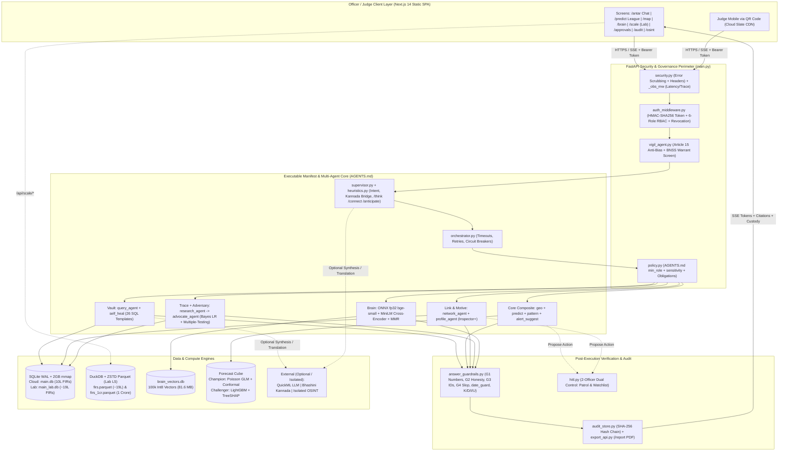

# 01 — Project Overview: ANTAR (Team Vimaraksha)

> **Event:** KSP Datathon 2026 Grand Finale — **29 October 2026** | Four Seasons Hotel Bengaluru at Embassy One (Main Hall — Grand Ballroom)
> **Slot:** `12:30 – 12:45 PM` (`8 min` Pitch/Demo + `5 min` Q&A) | **Presenter:** Harsha D B (**Team Vimaraksha**)
> **One-Line Purpose:** **Antar** (*"the insight within"*) is an offline-capable, bilingual (English + Kannada) conversational crime intelligence and calibrated patrol-forecasting platform built over Karnataka State Police (SCRB) First Information Report (FIR) records—engineered so **no unverified claim, fabricated number, or unchecked AI guess ever reaches a policing decision**.

---

## 1. Problem, Users, Solution & Value (In Plain Language)

*(Jargon defined on first use: **FIR** = First Information Report, the official police record opened when a cognizable offence is reported; **SCRB** = State Crime Records Bureau, Karnataka Police's central data custodian; **CCTNS** = Crime and Criminal Tracking Network & Systems, India's national police record system; **LLM** = Large Language Model, an AI text generator like ChatGPT or Llama; **SQL** = Structured Query Language, the exact database language used to count and filter rows.)*

### The Problem Police Face Today
1. **Data is locked behind technical filters:** Karnataka State Police holds **16.74+ lakh (~1.9 million in full Lab registry)** historical FIR records across **41 police districts, ~1,049 police stations, and ~1,134 beats**. A Station House Officer (SHO) or Superintendent of Police (SP) who wants to know *"Did burglary rise in Mysuru last quarter compared to the year before?"* or *"Which two cases share this UPI ID or vehicle number?"* must wait for a data cell analyst to export spreadsheets or run rigid reports.
2. **Standard AI chatbots are dangerous for policing:** A normal AI chatbot (like raw ChatGPT) guesses numbers ("hallucinates"), writes broken or unsafe database queries, invents suspect links from coincidence (e.g., two daily-wage labourers living in the same district), and gives no court-defensible audit trail.
3. **Patrol maps show yesterday's totals, not calibrated next-week risk:** Raw heatmaps only light up the largest stations every week without adjusting for area, seasonality, uncertainty bands, or historical hit rates.

### Who Uses Antar (6-Tier Police Role Hierarchy)
Defined in [`app/core/auth_middleware.py`](file:///d:/Project/app/core/auth_middleware.py#L29-L36) (`ROLES`):

| Role Rank | Police Persona | What They Do in Antar |
|---|---|---|
| **1. Constable** | Beat officer / Desk writer | Asks aggregate station/beat counts, views patrol shift plans, checks Kannada/English crime summaries. Blocked from person-level dossiers. |
| **2. SI** (Sub-Inspector) | Investigating Officer (IO) | Queries FIR case timelines, status breakdowns, and beat hotspots. |
| **3. Inspector** | Station House Officer (SHO) | Unlocks **person-level & cross-case intelligence**: co-accused networks (`network`), suspect risk profiles (`profile`), 2nd Brain MO similarity (`brain`), K/D/I/U dossiers (`research` + `advocate_agent`), and isolated open-web OSINT (`osint`). Can **propose** (never self-approve) patrol redeployments or watchlists. |
| **4. DSP** (DySP / ACP) | Sub-Division Officer | Sub-divisional corridor trends, multi-station linkage, hypothesis review. |
| **5. Approver** (SP / DCP) | Supervising Officer | **Human-in-the-Loop (HITL) Approver**: reviews and signs off (or rejects) proposed patrol redeployments and watchlist additions (`app/core/hitl.py`). |
| **6. Admin** | SCRB Command / IT Cell | Full audit-chain verification, CSV batch ingestion/rollback, token/officer revocation, benchmark & observability consoles. |

### The Antar Solution & Core USPs ("Vimaraksha: Predict & Secure Before the Threat Materialises")
1. **Deterministic Bilingual Chat (Never Raw LLM SQL):** Officers ask in plain **English or Kannada** (text or voice). Antar maps intents to **26 whitelisted parameterized SQL templates** ([`app/services/zcql_repo.py`](file:///d:/Project/app/services/zcql_repo.py))—an LLM **never** writes free-form SQL and **never** invents numbers. Every number in an answer is checked character-by-character against returned database rows by [`answer_guardrails.py::check_numbers`](file:///d:/Project/app/core/answer_guardrails.py#L86).
2. **Calibrated Champion-vs-Challenger Patrol Forecasting:** Compares statistical baselines, an exposure-offset **Poisson Generalized Linear Model (GLM)** ([`app/forecast/model.py`](file:///d:/Project/app/forecast/model.py)), and a **LightGBM Poisson Challenger with TreeSHAP** (`app/forecast/challenger.py` `[Lab L3]`) across rolling-origin backtests using **PAI** (Prediction Accuracy Index) and **PEI** (Predictive Efficiency Index), wrapped in **Mondrian split-conformal 80%/90% uncertainty bands**.
3. **Built-In Bayesian Devil's Advocate (`advocate_agent`):** The only police AI with an **LLM-free mathematical adversary** ([`app/agents/advocate_agent.py`](file:///d:/Project/app/agents/advocate_agent.py)) that prices every inferred link against population base rates, applies a **multiple-comparisons scan penalty**, and **blocks weak hypotheses with HTTP `409`** until an officer provides a written override reason.
4. **Dual-Tier Deployment (Cloud Instant + Lab Full-Scale):**
   - **Cloud Edition (`D:\Project_Antar` on Zoho Catalyst):** Zero-install web app (`10,00,000` FIRs in `2 GB` RAM container) judges can open right now via **QR code** on their phones.
   - **Lab Edition (`D:\Project`, `ANTAR_EDITION=lab`):** Full SCRB corpus (`main_lab.db`, `~19 lakh` FIRs `[VERIFY exact count in docs/lab/TOPUP_REPORT.md]`), **DuckDB + ZSTD Parquet columnar analytics** scaling up to **1 Crore (`1,00,00,000`) FIRs** in milliseconds (`app/services/scale_bench.py` `[Lab L5]`).
5. **Court-Grade Governance:** Every claim carries an **ICD-203 epistemic tag** (**K**nown / **D**erived / **I**nferred / **U**nknown), operational actions require **2-officer HITL approval** ([`app/core/hitl.py`](file:///d:/Project/app/core/hitl.py)), open-web OSINT is physically isolated from FIR tables ([`app/api/osint_api.py`](file:///d:/Project/app/api/osint_api.py)), and every turn writes to a **SHA-256 hash-chained audit ledger** ([`app/services/audit_store.py`](file:///d:/Project/app/services/audit_store.py)) exportable as a signed PDF report ([`app/api/export_api.py`](file:///d:/Project/app/api/export_api.py)).

---

## 2. Feature Matrix — End-to-End Working vs. Partial / Honest Boundaries

| Capability | Status | Edition | Evidence in Code & Honest Scope |
|---|---|---|---|
| **Bilingual EN + Kannada Chat (SSE Streaming)** | **End-to-End** | Cloud + Lab | [`app/api/chat_stream.py`](file:///d:/Project/app/api/chat_stream.py), [`app/agents/heuristics.py`](file:///d:/Project/app/agents/heuristics.py), [`app/core/kn_translit.py`](file:///d:/Project/app/core/kn_translit.py). Works offline via deterministic Kannada stemmer/bridge + online via Bhashini/Dwani/QuickML. |
| **26 Whitelisted SQL Templates + 5-Stage Self-Heal** | **End-to-End** | Cloud + Lab | [`app/agents/query_agent.py`](file:///d:/Project/app/agents/query_agent.py), [`app/agents/self_heal.py`](file:///d:/Project/app/agents/self_heal.py). Never fabricates on 0 rows; escalates through filter relaxation, dense ONNX recall, and BM25 before giving an honest dead-end with nearest match. |
| **"Why?" Glass-Box Reasoning Drawer & Confidence Score** | **End-to-End** | Cloud + Lab | [`chat_stream.py::_answer_confidence`](file:///d:/Project/app/api/chat_stream.py#L89), [`app/core/case_file.py`](file:///d:/Project/app/core/case_file.py). Shows exact SQL template, filters applied/dropped, rows scanned, and agent latency. |
| **150-Question Bilingual Gold Evaluation Card** | **End-to-End `[Lab L4]`** | Lab (+ `/docs`) | `scripts/eval_gold.py`, `app/api/accuracy_api.py`, `AccuracyCard.jsx`. Deterministic execution accuracy across counts, districts, YoY, statutes, Kannada, and out-of-coverage refusals (`35/35` on baseline; `[VERIFY 150-Q % in docs/ACCURACY.md]`). |
| **Two-Tier Second Brain (100k Int8 ONNX Vectors + Hybrid RRF)** | **End-to-End** | Cloud + Lab | [`app/second_brain/vec_store.py`](file:///d:/Project/app/second_brain/vec_store.py), [`onnx_backend.py`](file:///d:/Project/app/second_brain/onnx_backend.py), [`reranker.py`](file:///d:/Project/app/second_brain/reranker.py). Curated RAM index + 100k disk-chunked int8 FIR vectors (`81.6 MB`), torch-free CPU ONNX fp32. |
| **Calibrated Patrol Forecasting (GLM Champion + LightGBM Challenger)** | **End-to-End** | Cloud (GLM) / Lab (GLM + LGBM) | [`app/forecast/model.py`](file:///d:/Project/app/forecast/model.py), [`backtest.py`](file:///d:/Project/app/forecast/backtest.py), `challenger.py` & `league.py` `[Lab L3]`. GLM achieves **PAI@5% = 14.2** (`40.4%` all-crime capture in top 5% beat area; `52.0%` property crime capture in `23/23` weeks). LightGBM adds non-linear interactions + exact TreeSHAP (`[VERIFY league winner in docs/lab/MODEL_LEAGUE.md]`). |
| **MapLibre Beat/District Hotspots, Getis-Ord $G_i^*$ & Shift Plans** | **End-to-End** | Cloud + Lab | [`app/api/map_api.py`](file:///d:/Project/app/api/map_api.py), [`app/services/anomaly.py`](file:///d:/Project/app/services/anomaly.py), [`app/services/shift_plan.py`](file:///d:/Project/app/services/shift_plan.py). **Caveat:** ~30% of SCRB FIRs have usable Karnataka GPS coordinates; beat areas are Voronoi centroid estimates until official KSP GIS shapefiles are attached. |
| **Bayesian Devil's Advocate (`advocate_agent`) + `409` Confirm Gate** | **End-to-End** | Cloud + Lab | [`app/agents/advocate_agent.py`](file:///d:/Project/app/agents/advocate_agent.py), [`app/api/hypothesis.py`](file:///d:/Project/app/api/hypothesis.py#L168). 100% deterministic math; blocks `COLLAPSES`/`WEAKENED` transitions unless officer submits `acknowledge_challenge=true` + written justification. |
| **Suspect Risk Profiling (Exact Linear SHAP) & Co-Accused Network** | **End-to-End (Seeded PII)** | Cloud + Lab | [`app/agents/profile_agent.py`](file:///d:/Project/app/agents/profile_agent.py), [`app/agents/network_agent.py`](file:///d:/Project/app/agents/network_agent.py). **Caveat:** Official SCRB CSV contains person *counts* only (zero real citizen names by law); person graphs/profiles run on synthetic demonstration seeds (`ext_synthetic_identity`) and are ready for CCTNS person-table views. |
| **HITL Dual-Control Approvals & Vigil Article 15 Compliance** | **End-to-End** | Cloud + Lab | [`app/core/hitl.py`](file:///d:/Project/app/core/hitl.py), [`app/agents/vigil_agent.py`](file:///d:/Project/app/agents/vigil_agent.py). Blocks demographic targeting pre-query; enforces proposer $\neq$ approver + SHA-256 payload-hash echo. |
| **DuckDB + Parquet 19-Lakh & 1-Crore Columnar Scale Bench** | **End-to-End `[Lab L5]`** | Lab only | `app/services/scale_bench.py`, `app/api/scale_api.py`, `antar-frontend/app/(app)/scale/page.jsx`. Live SQLite row-store vs DuckDB columnar scan on 19L real FIRs and 1-Crore synthetic stress copy (`[VERIFY timings in docs/SCALE.md]`). |
| **Isolated OSINT Workbench** | **Partial (Live + Portal Links)** | Cloud + Lab | [`app/api/osint_api.py`](file:///d:/Project/app/api/osint_api.py), [`app/services/osint_checks.py`](file:///d:/Project/app/services/osint_checks.py), [`osint_recon.py`](file:///d:/Project/app/services/osint_recon.py). Runs live public checks (IFSC, RDAP, `crt.sh` TLS certs, Luhn, public search) + BNSS Sec 94 requisition templates; never touches FIR DB; tags everything `UNVERIFIED`. Paid commercial breach/CDR feeds require departmental API keys. |
| **Voice Input / Kannada TTS & Document OCR Upload** | **Partial (API-Dependent)** | Cloud + Lab | [`app/api/voice.py`](file:///d:/Project/app/api/voice.py), [`app/services/bhashini.py`](file:///d:/Project/app/services/bhashini.py), [`app/services/forensic_ocr.py`](file:///d:/Project/app/services/forensic_ocr.py). Live when Bhashini/Dwani/vision keys & network are active; falls back gracefully to text/sample extraction offline. |

---

## 3. System Architecture & End-to-End Data Flow

### 3.1 High-Level Architecture (Mermaid Diagram)



### 3.2 Step-by-Step Data Flow (From Officer Question to Verified Answer)
1. **Officer Input:** Officer types or speaks an English or Kannada question on `/antar` (e.g., *"Compare theft cases in Bengaluru City between 2022 and 2023"*). Frontend sends `POST /api/chat/stream` with `Authorization: Bearer <token>`.
2. **Gateway & Compliance Check:** [`auth_middleware.py`](file:///d:/Project/app/core/auth_middleware.py) verifies the HMAC-SHA256 token and binds a [`SecurityContext`](file:///d:/Project/app/core/security_context.py) (`role`, `officer`). [`vigil_agent.py::audit_request`](file:///d:/Project/app/agents/vigil_agent.py#L31) screens the prompt—if it asks to target a caste/religion (Article 15 violation), it rejects immediately before touching any data.
3. **Intent & Clock Resolution:** [`heuristics.py`](file:///d:/Project/app/agents/heuristics.py) + [`supervisor.py`](file:///d:/Project/app/agents/supervisor.py) classify intent, normalize Kannada/transliterated place & crime names (`kn_bridge`), and resolve relative time windows via `clock.today()` (`2024-03-31` in Lab `ANTAR_TODAY=real` mode so "last month" means March 2024).
4. **Policy-Gated Execution:** [`orchestrator.py::run_agent`](file:///d:/Project/app/core/orchestrator.py#L128) consults [`policy.py::decide`](file:///d:/Project/app/core/policy.py#L80) against [AGENTS.md](file:///d:/Project/AGENTS.md). If a `Constable` triggers a `person`-sensitive agent (`profile`, `network`, `research`), policy returns `DENY` cleanly.
5. **Deterministic SQL & Self-Heal:** [`query_agent.py`](file:///d:/Project/app/agents/query_agent.py) picks one of 26 parameterized templates in [`zcql_repo.py`](file:///d:/Project/app/services/zcql_repo.py) and executes read-only against SQLite (`RegistryConnection` with 2 GB `mmap`). If 0 rows return, [`self_heal.py`](file:///d:/Project/app/agents/self_heal.py) relaxes secondary filters or consults ONNX Second Brain (`corpus_recall`), never inventing rows.
6. **Adversarial & Output Guardrails:** If `research_agent` proposes an `[INFERRED]` suspect link, [`advocate_agent.py`](file:///d:/Project/app/agents/advocate_agent.py) computes its Bayesian posterior after base-rate and multiple-comparisons penalties. Then [`answer_guardrails.py::apply_guardrails`](file:///d:/Project/app/core/answer_guardrails.py#L173) verifies every number (`G1`), FIR/suspect ID (`G3`), future-date absence (`date_guard`), and attaches **K/D/I/U** tags.
7. **Streaming, Custody & Hash-Chain:** SSE events (`step` → `token` → `citations` → `confidence` → `custody` → `complete`) stream to the UI while [`audit_store.py::record_ai_reasoning`](file:///d:/Project/app/services/audit_store.py#L291) appends an immutable `SHA-256(prev_hash + payload)` entry to `audit_log`.

---

## 4. Folder Structure Explained (`D:\Project` Lab vs `D:\Project_Antar` Cloud)

```text
D:\Project\                         # Primary Engineering + Full Lab Build Workspace
├── AGENTS.md                       # Executable YAML agent manifest (single source of truth; tested in CI)
├── LabBuild_plan.md                # Full Lab specification (Phases L0–L6: 19L DB, LightGBM, 150-Q eval, DuckDB 1Cr)
├── main.py / run.py                # FastAPI application factory, middleware stack, lifespan warmup, Uvicorn launcher
├── main.db / main_lab.db [Lab]     # SQLite WAL databases (10L Cloud baseline / ~19L full SCRB Lab registry)
├── brain_vectors.db                # 100,000 int8-quantized 384-d FIR embeddings (81.6 MB on disk, ~3 MB scan RAM)
├── intelligent.db                  # Curated bilingual question bank & fast lookup sidecar
├── app/
│   ├── core/                       # Auth, RBAC policy, HITL, guardrails, RAG security, clock/edition [Lab], DB path, SSE
│   ├── agents/                     # 18 manifest-governed agents + LangGraph StateGraph + SQLite checkpointer + Advocate
│   ├── forecast/                   # Weekly crime cube, causal features, Poisson GLM, LightGBM challenger [Lab], PAI/PEI
│   ├── second_brain/               # Torch-free ONNX fp32 embedder & cross-encoder, int8 vec_store, hybrid RRF + MMR
│   ├── services/                   # Parameterized SQL repo (zcql_repo), anomaly (MAD-z, Gi*), DuckDB bench [Lab], OSINT
│   └── api/                        # 45+ FastAPI routers (/chat/stream, /forecast, /hypothesis, /hitl, /audit, /scale [Lab])
├── antar-frontend/                 # Next.js 14 + React 18 + Tailwind + MapLibre GL frontend
│   ├── app/(app)/                  # Authenticated screens: antar, predict, map, brain, profiles, network, scale [Lab], etc.
│   ├── components/                 # PillNav, OfficerSelector, LangToggle, ModelLeague [Lab], AccuracyCard [Lab], etc.
│   └── lib/                        # API wrapper (waking retry + Bearer auth), SSE parser, i18n strings
├── models/onnx/                    # Exported offline ONNX weights (bge-small-en-v1.5 & ms-marco-MiniLM-L-6-v2)
├── data/                           # Census 2011, NFHS-5, obs/audit/session DBs, gold_150.json [Lab], parquet/ [Lab]
├── scripts/                        # DB builders, ONNX parity scripts, eval_gold.py [Lab], scripts/lab/* [Lab]
├── tests/                          # 149 pytest files (1,988+ automated unit, security, math & manifest tests)
├── docs/                           # Architecture, security, forecast backtest, accuracy & scale reports
└── demo-prep/                      # THIS FOLDER: 7 complete Grand Finale preparation guides
```

> **How `D:\Project_Antar` differs:** `D:\Project_Antar` is the stripped, production-packaged **Zoho Catalyst Cloud mirror** (`ANTAR_EDITION=cloud`). It ships `main.db.gz` (`152 MB` compressed → `1.61 GB` staged into `/tmp/antar/main.db` at container boot), static Next.js export (`basePath: "/app"` for Catalyst Slate CDN), and omits heavy `tests/`, raw CSVs, and Parquet stress files to fit Catalyst AppSail's container budget.
