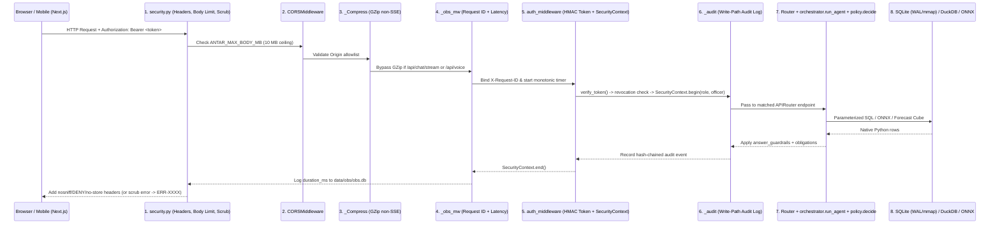

# 03 — Backend Deep Dive: Architecture, Lifecycle, Schema, Security & Code Traces

> **Scope:** Grounded line-by-line in `D:\Project` (including `[Lab L0–L6]` extensions from [`LabBuild_plan.md`](file:///d:/Project/LabBuild_plan.md)). Every claim cites the exact file and function so you can defend any backend question from first principles.

---

## 1. Application Startup & Boot Sequence (`run.py` → `main.py`)

### Step-by-Step Boot Order
1. **Launcher ([`run.py`](file:///d:/Project/run.py)):**
   - [`log_capacity()`](file:///d:/Project/run.py#L14-L32) reads Linux cgroup v1/v2 memory limits (`/sys/fs/cgroup/memory.max`) and `psutil` RSS so container memory ceilings (`2 GB` on Catalyst AppSail) are logged on line 1 of boot.
   - Resolves bind port in strict priority: `X_ZOHO_CATALYST_LISTEN_PORT` (`9000` in AppSail) → `PORT` → `APP_PORT` → `8000` (local Lab default), launching `uvicorn.run("main:app", workers=1)`.
2. **Pre-Import Guards ([`main.py`](file:///d:/Project/main.py#L1-L43)):**
   - Reconfigures Windows `stdout`/`stderr` to `utf-8` so Kannada script logs never crash with `UnicodeEncodeError`.
   - Sets `HF_HUB_OFFLINE=1` and `TRANSFORMERS_OFFLINE=1`—the server **never** phones home to HuggingFace at runtime.
   - Caps BLAS threads (`OMP_NUM_THREADS=1`, `MKL_NUM_THREADS=1`, `OPENBLAS_NUM_THREADS=1`).
   - **Critical Windows/Linux DLL Rule:** Executes `import onnxruntime` **before** `scikit-learn` / `scipy` so ONNX Runtime initializes its OpenMP runtime cleanly without colliding with Intel/LLVM OpenMP DLLs.
3. **FastAPI `lifespan()` & `background_warmup()` ([`main.py`](file:///d:/Project/main.py#L46-L185)):**
   - **Synchronous fast boot (`<1 sec`):**
     - [`ensure_db_staged()`](file:///d:/Project/app/core/db_path.py#L132): On Catalyst Cloud, gunzips `/app/main.db.gz` (`83–152 MB`) into `/tmp/antar/main.db` (`1.61 GB`) once; on Lab (`ANTAR_EDITION=lab`), points straight at `D:\Project\main_lab.db` (`~19 lakh` FIRs) with WAL + `2 GB` `mmap`.
     - Initializes hash-chained `audit_log` ([`audit_store.init_db()`](file:///d:/Project/app/services/audit_store.py#L128)), officer memory ([`init_memory_db()`](file:///d:/Project/app/core/memory.py#L19)), and parses [AGENTS.md](file:///d:/Project/AGENTS.md) via [`register_default_fleet()`](file:///d:/Project/app/core/orchestrator.py#L96) + [`agent_lock.enforce()`](file:///d:/Project/app/agents/agent_lock.py#L118).
   - **Non-blocking `asyncio.create_task(background_warmup())`:** Server begins accepting `/api/health` immediately (preventing cloud load-balancer boot timeouts) while warming in background:
     1. Covering SQLite indexes & `crimes` view ([`zcql_local.ensure_indexes()`](file:///d:/Project/app/services/zcql_local.py#L49)).
     2. ONNX `bge-small-en-v1.5` embedder & `ms-marco-MiniLM` cross-encoder ([`onnx_backend.py`](file:///d:/Project/app/second_brain/onnx_backend.py)), curated `BrainIndex`, and 100k int8 `vec_store` (`brain_vectors.db`).
     3. District cache, co-accused `graph_cache`, `evidence_ledger`, and forecast `ensure()` ([`app/forecast/run.py`](file:///d:/Project/app/forecast/run.py#L178)).
     4. Starts [`orchestrator.start_autonomous()`](file:///d:/Project/app/core/orchestrator.py#L280) background loop (periodic Sentinel watch scans, corridor refresh, and scheduled forecast refits).

---

## 2. Full HTTP Request Lifecycle (Middleware Stack Order)

*(Jargon check: **Middleware** = wrapper layers in FastAPI that inspect every request on the way **in** and every response on the way **out**—note that Starlette/FastAPI executes `add_middleware` in **reverse** registration order, so outermost runs first.)*



---

## 3. Master API Endpoint Reference Table (Key Surfaces Across 45+ Routers)

*(Auth legend: **Public** = open for login/health; **Authenticated (`Constable+`)** = any signed-in officer; **`Inspector+`** = rank $\ge$ Inspector; **`Approver+`** = SP/DCP/Admin; **`Admin`** = SCRB Admin only.)*

| Method & Path | Router File & Function | Purpose | Request / Query Shape | Response Highlights | Auth |
|---|---|---|---|---|---|
| `GET /api/health` | [`health.py::health_check`](file:///d:/Project/app/api/health.py#L52) | Liveness, edition, DB row readiness, ONNX Brain backend & corpus count | None | `{status, brain_backend: "onnx/fp32", brain_corpus_rows: 100000, ...}` | Public |
| `POST /api/auth/login` | [`auth_api.py::login`](file:///d:/Project/app/api/auth_api.py#L35) | Verify officer credentials & mint 12h HMAC-SHA256 token | `{officer, password}` | `{token, officer, role, expires_at}` | Public (rate-limited) |
| `POST /api/auth/revoke` | [`auth_api.py::revoke_officer`](file:///d:/Project/app/api/auth_api.py#L65) | Immediately block compromised token or officer ID | `{officer}` | `{revoked: true}` | `Admin` |
| `POST /api/chat/stream` | [`chat_stream.py::chat_stream`](file:///d:/Project/app/api/chat_stream.py#L893) | Primary bilingual SSE intelligence pipeline | `{text, lang, session_id, deep_think}` | SSE stream: `step`, `token`, `citations`, `brain_hits`, `visual`, `confidence`, `custody`, `complete` | `Constable+` (per-agent `policy.decide` inside) |
| `POST /api/chat` | [`chat.py::chat`](file:///d:/Project/app/api/chat.py#L72) | Synchronous compiled LangGraph `StateGraph` turn | `{text, session_id, lang}` | `{answer, citations, reasoning, confidence, visuals}` | `Constable+` |
| `GET /api/forecast/hotspots` | [`forecast_api.py::hotspots`](file:///d:/Project/app/api/forecast_api.py#L51) | Ranked next-week station/beat hotspots with 80%/90% conformal bands | `?level=beat&category=property&top=25&model=champion\|challenger` | `[{unit, expected, band_80, band_90, pai, drivers}]` | `Constable+` |
| `GET /api/forecast/scorecard` | [`forecast_api.py`](file:///d:/Project/app/api/forecast_api.py) | Rolling-origin backtest metrics (PAI@5%/10%, PEI, coverage) | `?category=all` | `{weeks: 23, pai_5: 14.2, capture_5: 0.404, ...}` | `Constable+` |
| `GET /api/forecast/league` `[Lab L3]` | `forecast_api.py` / `league.py` | 5-model Champion vs Challenger comparison + TreeSHAP | `?category=property&level=station` | `{models: [naive, ma4, seasonal52, glm, lightgbm], winner}` | `Constable+` |
| `GET /api/forecast/shift-plan` | [`forecast_api.py::shift_plan`](file:///d:/Project/app/api/forecast_api.py#L139) | Time-of-day × weekday beat patrol roster | `?unit=Bengaluru+City` | `{shifts: [morning, evening, night], priority_beats}` | `Constable+` |
| `GET /api/map/gi-star` | [`map_api.py::gi_star_hotspots`](file:///d:/Project/app/api/map_api.py#L156) | Getis-Ord $G_i^*$ statistically significant spatial clusters | `?crime_type=...` | GeoJSON features with `z_score` & `p_value` | `Constable+` |
| `GET /api/brain/similar` | [`brain.py::similar_cases`](file:///d:/Project/app/api/brain.py#L79) | 2-tier ONNX semantic + BM25 RRF + Cross-Encoder + MMR case recall | `?q=...&k=10` | `{curated_hits, corpus_hits (tagged DERIVED)}` | `Inspector+` |
| `GET /api/profile/{id}` | [`profile.py::profile`](file:///d:/Project/app/api/profile.py#L173) | Suspect risk score + exact linear SHAP factor breakdown + associates | Path `suspect_id` | `{risk_score, shap_factors, crimes, leads}` | `Inspector+` |
| `GET /api/graph/{id}` | [`graph.py::get_graph`](file:///d:/Project/app/api/graph.py#L55) | Co-accused & shared phone/vehicle/UPI/IP network subgraph | Path `suspect_id` | `{nodes, edges, communities, bridge_scores}` | `Inspector+` |
| `GET /api/hypothesis/{id}/challenge` | [`hypothesis.py::challenge_hypothesis`](file:///d:/Project/app/api/hypothesis.py#L151) | Read-only `advocate_agent` Bayesian base-rate & falsification preview | Path `id` | `{verdict, posterior, lr_breakdown, scan_size, would_gate_confirm, falsifiers}` | `Inspector+` |
| `POST /api/hypothesis/{id}/confirm` | [`hypothesis.py::confirm_hypothesis`](file:///d:/Project/app/api/hypothesis.py#L168) | Transition `Inferred → Known` (**returns `409`** if `COLLAPSES`/`WEAKENED` without override) | `{acknowledge_challenge, reason}` | `200` confirmed + audit entry, OR `409` with full rebuttal | `Inspector+` |
| `POST /api/hitl/propose` | [`hitl_api.py::propose`](file:///d:/Project/app/api/hitl_api.py#L57) | Propose `patrol_redeployment` (12h) or `watchlist_add` (72h, Vigil-screened) | `{action_type, payload, justification}` | `202 Accepted` `{action_id, payload_hash, status: "PENDING"}` | `Inspector+` |
| `POST /api/hitl/{id}/decide` | [`hitl_api.py`](file:///d:/Project/app/api/hitl_api.py) | Approve/Reject pending action (proposer $\neq$ approver + hash echo) | `{decision, payload_hash, note}` | `{status: "APPROVED", executed_result}` | `Approver+` |
| `POST /api/osint/investigate` | [`osint_api.py::investigate`](file:///d:/Project/app/api/osint_api.py#L78) | Isolated open-web check (phone/IFSC/UPI/domain/IP); zero FIR access | `{identifier, reason}` | `{unverified: true, live_checks, bnss_requisition}` | `Inspector+` |
| `GET /api/audit/verify` | [`audit.py::audit_integrity`](file:///d:/Project/app/api/audit.py#L30) | Recomputes entire SHA-256 chain from genesis to detect tampering | None | `{valid: true, total_events, head_hash}` | `Constable+` / `Admin` |
| `GET /report/{session_id}` | [`export_api.py::report`](file:///d:/Project/app/api/export_api.py#L312) | Court-printable HTML/PDF report with K/D/I/U badges & `DOC_ROOT` SHA-256 | Path `session_id` | Print-ready HTML (`403` unless session owner or `Admin`) | Owner or `Admin` |
| `GET /api/eval/accuracy` `[Lab L4]` | `accuracy_api.py` | 150-question bilingual gold benchmark breakdown | None | `{total: 150, passed, by_category, failures}` | `Constable+` |
| `GET /api/scale/run` `[Lab L5]` | `scale_api.py` | Live SQLite vs DuckDB-on-Parquet latency benchmark (19L & 1 Crore) | `?tier=19l\|1cr` | `{queries: [{name, sqlite_ms, duckdb_ms, speedup}]}` | `Constable+` |
| `GET /api/schema/tables` `[Lab L2]` | `schema_api.py` | Full SCRB 21 master + 5 derived ER table inventory & row counts | None | `{master_tables, derived_tables, zero_pii_note}` | `Constable+` |

---

## 4. Database Architecture: Schema, Relationships, Indexing & Migrations

### 4.1 Multi-Database Layout & Why Sidecars Are Split
1. **`main.db` (`1.61 GB`, 10L FIRs in Cloud) / `main_lab.db` (`~3 GB`, ~19L FIRs in Lab `[Lab L1]`):**
   - **Core fact table:** `FIRs` (`FIR_ID` PK, `District_Name`, `UnitName`, `FIRNo`, `Year`, `Month`, `Offence_From_Date`, `FIR_Reg_DateTime`, `CrimeGroup_Name`, `CrimeHead_Name`, `ActSection`, `FIR_Stage`, `Crime_No`, `Latitude`, `Longitude`, `Beat_Name`, `MO_Details`, `Male`, `Female`, etc.) exposed cleanly via the normalized SQL view `crimes` ([`zcql_local.py::_ensure_crimes_view`](file:///d:/Project/app/services/zcql_local.py#L30)).
   - **21 Official SCRB Master Tables:** `Act`, `District`, `Unit`, `UnitType`, `CrimeHead`, `CrimeSubHead`, `CaseStatusMaster`, `CaseCategory`, `GravityOffence`, `Court`, `Rank`, `Designation`, `Employee`, `ArrestSurrenderType`, `OccupationMaster`, `GenderMaster`, `Nationality`, `State`, `BloodGroupMaster`, `CasteMaster`, `ReligionMaster` *(note: Caste/Religion masters exist in SCRB schema for statutory SC/ST POA reporting, while `vigil_agent` blocks discriminatory targeting)*.
   - **5 Derived ER Tables `[Lab L2]` (`scripts/lab/derive_er_tables.py`):**
     - `FIR_Acts(FIR_ID, Act_Text, Section_Text)` — `1:N` explosion of multi-section `ActSection` strings (e.g., `"IPC 1860 U/s: 379,34"` → 2 indexed statute rows).
     - `UnitJurisdiction(UnitName, District_Name, Beat_Count, First_FIR, Last_FIR, FIR_Count)` — rolled up from FIRs.
     - `Accused`, `Victim`, `ComplainantDetails` — created with exact SCRB ER schema at **0 rows** (`ext_schema_notes` documents why: official SCRB extract carries aggregate gender counts, zero citizen PII).
   - **Investigation, Forecast & Governance Tables:** `suspects`, `crime_suspects` (many-to-many bridge), `relationships`, `money_accounts`, `money_transactions`, `geo_units`, `forecast_cube`, `forecast_models`, `forecast_output`, `forecast_feedback`, `hitl_actions`, `audit_log` (hash-chained), `officers`, `revoked_tokens`, `revoked_officers`, `saved_findings`.
2. **`brain_vectors.db` (`81.6 MB`):** `brain_vectors(row_id PK, kind, summary_text, meta_json, dim, scale, vec BLOB, created_at)` — holds curated intelligence + 100,000 `int8` FIR vectors.
3. **`data/parquet/firs.parquet` & `firs_1cr.parquet` `[Lab L5]`:** Columnar ZSTD Parquet snapshots queried directly by DuckDB (`scale_bench.py`).
4. **`data/sessions.db`, `data/obs/obs.db`, `data/obs/case_file.db`:** Isolated operational write stores so chat history and telemetry writes never contend with `main.db` / `main_lab.db`.

### 4.2 Indexing & Migration Strategy
- **30 Covering & Composite Indexes** (idempotently applied at boot via `CREATE INDEX IF NOT EXISTS` in [`zcql_local.py::ensure_indexes`](file:///d:/Project/app/services/zcql_local.py#L49)), notably `idx_firs_abs_cov`, `idx_firs_u_zone_ct`, `idx_firs_group_date`, `idx_firs_u_zone_status`, `idx_crime_suspects_sid`, `ix_forecast_cube_unit`, and `[Lab L2]` `ix_fir_acts_section`.
- **Schema Evolution:** Idempotent `CREATE TABLE IF NOT EXISTS` + column-existence introspection (`PRAGMA table_info(...)`) at module startup (`db_path.py`, `zcql_local.py`, `audit_store.py`, `forecast/store.py`)—zero destructive migrations, preserving existing data across upgrades.

---

## 5. Auth, Security, Guardrails & Honest Known Weaknesses

### Defense-in-Depth Layers
1. **Authentication (`auth_middleware.py`):**
   - **Token Mode** (when `ANTAR_AUTH_SECRET` is set): `POST /api/auth/login` verifies `scrypt`/`pbkdf2` password hashes ([`accounts.py`](file:///d:/Project/app/core/accounts.py)) with brute-force lockout (`locked_for`), minting `base64url(payload).base64url(HMAC_SHA256)` (`12h` expiry). Every request checks [`revocation.is_revoked()`](file:///d:/Project/app/core/revocation.py#L95).
   - **Header Mode** (local Lab convenience when `ANTAR_AUTH_SECRET` is unset): Reads `X-Role` and `X-Officer` from [`OfficerSelector.jsx`](file:///d:/Project/antar-frontend/components/OfficerSelector.jsx) so judges can switch live between `Constable`, `Inspector`, and `Approver` during the demo!
2. **Dual RBAC + Policy Obligations ([`policy.py`](file:///d:/Project/app/core/policy.py)):**
   - Checked both at FastAPI router dependencies (`require_role("Inspector")`) **and** inside [`orchestrator.run_agent`](file:///d:/Project/app/core/orchestrator.py#L128) via [AGENTS.md](file:///d:/Project/AGENTS.md) (`min_role`, `sensitivity`, `obligations`: `redact_pii` with Verhoeff-checked Aadhaar masking in [`guardrails.py::verhoeff_ok`](file:///d:/Project/app/core/guardrails.py#L27), `aggregate_only` stripping person keys, `label_unverified`, `row_cap`).
3. **Egress Firewall & OSINT Air-Gap ([`egress.py`](file:///d:/Project/app/core/egress.py) & [`osint_api.py`](file:///d:/Project/app/api/osint_api.py)):**
   - `osint` has `graph_node: null` and `routes: []` in [AGENTS.md](file:///d:/Project/AGENTS.md)—a chat query can **never** leak an FIR subject to the open web. In `/api/osint/investigate`, the officer's searched identifier is **SHA-256 hashed** before hitting the audit log so unverified citizen queries don't create a shadow dossier.
4. **Known Security Tradeoffs (State Honestly if Asked!):**
   - **`sessionStorage` Bearer Token vs `HttpOnly` Cookie:** Cross-origin hosting (Catalyst Slate static CDN → AppSail API domain) required `Authorization: Bearer` in `sessionStorage` ([`antar-frontend/lib/api.js`](file:///d:/Project/antar-frontend/lib/api.js#L18)). On KSP on-prem intranet behind a single Nginx origin, tokens move to `HttpOnly; Secure; SameSite=Strict` cookies.
   - **`/docs` Live Widget Header Gap:** [`antar-frontend/lib/chatStream.js`](file:///d:/Project/antar-frontend/lib/chatStream.js#L80) omits the `Authorization` header (whereas `/antar/page.jsx` attaches it). Always run live authenticated chat from `/antar` when `ANTAR_AUTH_SECRET` is enabled.
   - **Cloud Demo Role Buttons:** Only the public Cloud showcase bundle includes one-click Demo Access role buttons for hackathon judges; `ANTAR_EDITION=lab` / KSP deployment disables public demo buttons.

---

## 6. Background Jobs, Caching, Error Handling & Deployment

- **Autonomous Loop ([`orchestrator.py::_autonomous_loop`](file:///d:/Project/app/core/orchestrator.py#L258)):** Runs under `SecurityContext.system()`, ticking `sentinel` watch scans, `products` (`product_store.refresh_expiring` SQLite-backed TTL cache in `product_cache`), and checking [`forecast/refit.py::due()`](file:///d:/Project/app/forecast/refit.py#L58) for weekly model refits in an isolated child process (`forecast/child.py`).
- **Error Scrubbing ([`security.py`](file:///d:/Project/app/core/security.py)):** Unhandled exceptions never leak file paths, SQL queries, URLs, or tokens—[`public_error()`](file:///d:/Project/app/core/security.py#L113) logs the full traceback server-side under `ERR-<10HEX>` and returns a clean stage-specific message + reference ID.
- **How to Run Locally (Lab Mode on `D:\Project`):**
  ```powershell
  # Terminal 1 — Backend (Lab Edition, 19L DB, Real-Date Clock 2024-03-31)
  $env:TMP="D:\tmp"; $env:TEMP="D:\tmp"
  $env:ANTAR_EDITION="lab"
  $env:ANTAR_DB_PATH="D:\Project\main_lab.db"   # falls back to D:\Project\main.db if testing pre-topup
  $env:ANTAR_TODAY="real"
  D:\Project\.venv\Scripts\python.exe run.py    # listens on http://127.0.0.1:8000

  # Terminal 2 — Frontend
  cd D:\Project\antar-frontend
  npm run dev                                   # listens on http://localhost:3000
  ```

---

## 7. Three Key Flows Traced Step-by-Step (With File & Function Citations)

### Trace 1: Bilingual Crime Query + Self-Heal + Guardrails + Audit
1. **Client:** `/antar/page.jsx` posts `{text: "ಮೈಸೂರು ನಗರದಲ್ಲಿ ಕಳ್ಳತನ ಪ್ರಕರಣಗಳು ಎಷ್ಟು?", lang: "kn"}` to `POST /api/chat/stream`.
2. **Stream Entry:** [`chat_stream.py::chat_stream`](file:///d:/Project/app/api/chat_stream.py#L893) opens [`_TracedTurn`](file:///d:/Project/app/api/chat_stream.py#L139) and invokes [`_run_pipeline()`](file:///d:/Project/app/api/chat_stream.py#L195).
3. **Compliance & Kannada Bridge:** [`vigil_agent.py::audit_request`](file:///d:/Project/app/agents/vigil_agent.py#L31) approves; [`heuristics.py::is_kannada`](file:///d:/Project/app/agents/heuristics.py#L208) + [`kn_bridge`](file:///d:/Project/app/agents/heuristics.py#L187) + [`kn_query.py::to_english`](file:///d:/Project/app/second_brain/kn_query.py#L107) strip `-ದಲ್ಲಿ` (`ಮೈಸೂರು ನಗರ` → `Mysuru City`, `ಕಳ್ಳತನ` → `THEFT`).
4. **Template SQL Execution:** [`orchestrator.py::run_agent("query", ...)`](file:///d:/Project/app/core/orchestrator.py#L128) checks [`policy.py::decide`](file:///d:/Project/app/core/policy.py#L80) (`PERMIT` for `Constable+`), calling [`query_agent.py::select_template`](file:///d:/Project/app/agents/query_agent.py#L737) → [`zcql_repo.py`](file:///d:/Project/app/services/zcql_repo.py) → [`zcql_local.py::_fir_where`](file:///d:/Project/app/services/zcql_local.py#L317) (capped at `clock.today()` = `2024-03-31`). *(If 0 rows hit, [`self_heal.py::self_heal`](file:///d:/Project/app/agents/self_heal.py#L217) relaxes secondary filters or runs ` _semantic_rows`.)*
5. **Verification & Custody:** [`answer_writer.py`](file:///d:/Project/app/agents/answer_writer.py) formats the answer from exact SQL rows; [`answer_guardrails.py::apply_guardrails`](file:///d:/Project/app/core/answer_guardrails.py#L173) runs `check_numbers` (`G1`) and `check_identifiers` (`G3`); [`layout_composer.py::build_custody`](file:///d:/Project/app/agents/layout_composer.py#L141) builds the provenance receipt; [`audit_store.py::record_ai_reasoning`](file:///d:/Project/app/services/audit_store.py#L291) writes the `SHA-256` chain link.

### Trace 2: Adversarial Hypothesis Gate (`409 Conflict` → Officer Override)
1. **Dossier & Scoring:** Inspector researches anchor suspect `S0001` via [`graph.py::research_node`](file:///d:/Project/app/agents/graph.py#L239) → [`research_agent.py::run_research`](file:///d:/Project/app/agents/research_agent.py#L134), which scores candidate co-offender pairs (`_score_hypothesis_pair:L43`) and automatically invokes [`advocate_agent.py::challenge`](file:///d:/Project/app/agents/advocate_agent.py) inside the same node.
2. **Bayesian Base-Rate & Scan Audit:** [`advocate_agent.py::_Index`](file:///d:/Project/app/agents/advocate_agent.py#L114) counts actual population frequencies across `suspects` & `crime_suspects`. It computes per-signal conditional likelihood ratios (`_lr_from_count`) **and** unconditional pair-collision probabilities (`_collision_p`) adjusted for the multiple-comparisons scan size $\binom{N}{2}$ (or $N-1$ for anchored scans). Because "shared district + common occupation" collides thousands of times by chance, posterior $< 0.90$ → verdict = **`WEAKENED`** or **`COLLAPSES`**.
3. **Hard Gate on Confirm:** Officer clicks **Confirm Hypothesis** → `POST /api/hypothesis/{id}/confirm` ([`hypothesis.py::confirm_hypothesis`](file:///d:/Project/app/api/hypothesis.py#L168)). Seeing `acknowledge_challenge=False` on a `WEAKENED`/`COLLAPSES` verdict, FastAPI raises **HTTP `409 Conflict`** returning the full mathematical rebuttal + Popperian falsifiers (`what evidence would disprove this`).
4. **Audited Override:** Only if the Inspector resubmits with `acknowledge_challenge=True` and a non-empty written `reason` does [`confirm_hypothesis`](file:///d:/Project/app/api/hypothesis.py#L168) promote the hypothesis and log **both** the AI's `COLLAPSES` warning and the officer's signed reason into `audit_log`.

### Trace 3: Patrol Forecast → HITL Proposal → Second-Officer Approval
1. **Weekly Forecast Generation:** [`forecast/features.py::load_panel`](file:///d:/Project/app/forecast/features.py#L284) builds the dense `(unit × crime_group × ISO_week)` panel up to `asof.real_record_end()` (`2024-03-31`). [`forecast/model.py::fit`](file:///d:/Project/app/forecast/model.py) trains the exposure-offset Poisson GLM (and `[Lab L3]` `challenger.py` trains `LGBMRegressor(objective="poisson")`), [`_calibrate()`](file:///d:/Project/app/forecast/model.py#L147) computes Mondrian 80%/90% conformal intervals, and [`reconcile()`](file:///d:/Project/app/forecast/model.py#L180) reconciles beat counts to station totals.
2. **Action Proposal (`202 Accepted`):** From `/predict` or Beacon (`alert_suggest_agent`), an `Inspector` proposes redeploying two beats via `POST /api/hitl/propose` ([`hitl_api.py::propose`](file:///d:/Project/app/api/hitl_api.py#L57) → [`hitl.py`](file:///d:/Project/app/core/hitl.py)). [`hitl.py`](file:///d:/Project/app/core/hitl.py) computes `payload_hash = SHA256(canonical_json)`, sets `12h` expiry, and stores status `PENDING` in `hitl_actions`.
3. **Separation-of-Duties Enforcement:** If the same Inspector tries `POST /api/hitl/{id}/decide`, [`hitl.py`](file:///d:/Project/app/core/hitl.py) rejects with `HitlError` (*proposer cannot approve own action*). When a different officer with role `Approver` (SP/DCP) submits `decision="APPROVE"` echoing the exact `payload_hash` they reviewed, [`_exec_patrol()`](file:///d:/Project/app/core/hitl.py#L116) records the active deployment order and appends a hash-chained receipt to `audit_log`.
