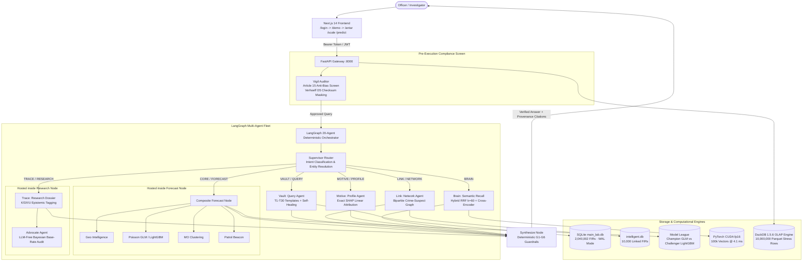

# Antar — Architecture & System Components
**Source 1: Ground Truth Reference for System Topology, Node Interfaces, and Component Architecture**

---

## 1. High-Level Architectural Paradigm

Antar represents a fundamental departure from standard generative AI chatbots in policing. Traditional LLMs in law enforcement fail because they suffer from:
1. **Hallucinated Penal Charges:** LLMs invent statutes, misattribute BNS/IPC sections, or blend non-existent sub-clauses.
2. **Ungrounded Associations:** Speculative cross-case links that do not exist in official General Diary entries or evidentiary records.
3. **Mode Dropping & Non-Reproducibility:** A prompt submitted twice produces different answers, destroying evidentiary weight in court.
4. **Free SQL Injection Vulnerabilities:** Black-box text-to-SQL allows schema corruption, prompt leakage, and data manipulation.

**Antar's Solution:** A **System 1 Deterministic Architecture**. Free-form text generation and uncontrolled SQL queries are strictly barred. Every user prompt is classified into validated intent routes and executed via 26 whitelisted parameterized analytical templates (`T1–T30`), closed-form statistical algorithms, and mathematically calibrated prediction bounds.

---

## 2. Core Subsystems & Components

### 2.1 Web Presentation & Operations UI (`antar-frontend/`)
Built with **Next.js 14.2.35**, React 18.3.1, and Tailwind/Lucide icons:
- **Authentication Gateway (`app/(auth)/login/page.jsx`):** Root localhost (`/`) immediately opens the secure login portal. Supports two strict disjoint roles: `U-7001` (**Admin / Operations Officer**) and `U-9001` (**Approver / Supervising Officer**).
- **Presentation & Architecture Launchpad (`app/demo/page.jsx` & `HookPresentation.jsx`):** Clean, pristine white minimal interface with signature Antar product cyan (`#0A7E8C`) highlights. Summarizes the manifesto, the technical implementation stack, and the interactive capabilities breakdown.
- **Operations Console (`app/(app)/antar/page.jsx` & `ChatConsole.jsx`):** The primary chat stream interface supporting streaming multi-agent execution, live reasoning traces, visual charts, and citation badges.
- **Spatio-Temporal Model League (`components/ModelLeague.jsx` in `/predict`):** Live head-to-head backtest dashboard comparing the Poisson GLM Champion vs. LightGBM Challenger with TreeSHAP driver attribution and Mondrian conformal confidence bands.
- **Interactive 3D Constellation (`components/Constellation3D.jsx` in `/antarBrain`):** Three.js and WebGL-accelerated 3D graph visualizer displaying 10,000 interconnected FIR records with directional link pulses and cluster physics.
- **1-Crore Row Analytical Stress Playground (`components/ScaleScreen.jsx` in `/scale`):** Real-time interactive benchmarking console comparing SQLite vs. DuckDB across 10,000,000 stress records with verified 100% test pass rate.

### 2.2 Compliance & Pre-Execution Screening (`app/agents/vigil_agent.py`)
- Audits incoming requests before any data agent touches them.
- **Article 15 Compliance:** Scans prompts for prohibited demographic discrimination (caste, religion, community targeting) and immediately rejects them with statutory citations.
- **Verhoeff Checksum $D_5$ Aadhaar Scrubbing:** Validates 12-digit numbers using the dihedral group $D_5$ algorithm; valid Aadhaar numbers are automatically masked (`XXXXXXXX1234`) to prevent PII leakage.

### 2.3 The LangGraph Orchestrator (`app/agents/`)
Compiled via **LangGraph 0.6.11** with `SqliteSaver` checkpointer for session state preservation:
- **Supervisor Router (`app/agents/supervisor.py`):** Zero-assumption intent router. Classifies officer queries into uppercase route labels (`VAULT`, `LINK`, `MOTIVE`, `FORECAST`, `GEO`, `PREDICT`, `PATTERN`, `ALERTS`, `TRACE`, `RESEARCH`, `BRAIN`, `CHITCHAT`).
- **Query Agent (`app/agents/query_agent.py`):** The deterministic spine. Maps requests to 26 whitelisted SQL templates (`T1–T30`). Escalates through a 5-tier self-healing ladder (Template Reroute -> SQL Miner Relaxation -> Dense Semantic Recall -> Hybrid BM25 -> Honest Dead-End).
- **Network Agent (`app/agents/network_agent.py`):** Constructs bipartite multi-hop connection graphs spanning crimes, suspects, vehicles, phone hashes, UPI IDs, and IP addresses using NetworkX.
- **Profile Agent (`app/agents/profile_agent.py`):** Evaluates suspect MOs and recidivism indicators using an exact linear-additive risk score ($100 \times \sum w_i f_i$), calculating closed-form SHAP attributions with zero approximation.
- **Forecast Composite Node (`app/agents/graph.py`):** Runs four co-located analytical agents (`geo`, `predict`, `pattern`, `alert_suggest`) concurrently to avoid quadruple full-table scans. Enforces `date_guard` (bars ungrounded future calendar dates).
- **Research Node (`app/agents/graph.py`):** Generates dossiers tagging all claims with epistemic markers:
  - **[K] Known:** Backed directly by official FIR rows.
  - **[D] Derived:** Algorithmic calculation (e.g. PageRank, density).
  - **[I] Inferred:** Hypothesis generated from cross-case links.
  - **[U] Unknown:** Missing or unverified data points.
- **Advocate Agent (`app/agents/advocate_agent.py`):** An adversarial, LLM-free Bayesian auditor that challenges all `[I]` inferred links against empirical base rates and multiple-testing corrections.
- **Synthesize Node (`app/agents/graph.py`):** Formulates the final response, enforces statutory disclaimers, and validates that every asserted figure matches the raw database output (Guardrail G1).

### 2.4 Analytical Storage & Compute Engines
- **Relational OLTP (SQLite 3.53.1):** Stores 2,040,002 official KSP FIR rows in `main_lab.db` with WAL mode enabled and foreign keys strictly enforced.
- **Columnar OLAP (DuckDB 1.5.6):** Executes vectorized queries across 10 ZSTD-compressed Parquet partitions (`scale/firs_stress_1cr/`, 10,000,000 rows) at sub-250 ms latencies.
- **PyTorch CUDA Tensor Acceleration:** Scans 100,000 384-dimensional int8 vector embeddings in **4.17 ms** on local GPU hardware (NVIDIA GeForce GTX 1650).
