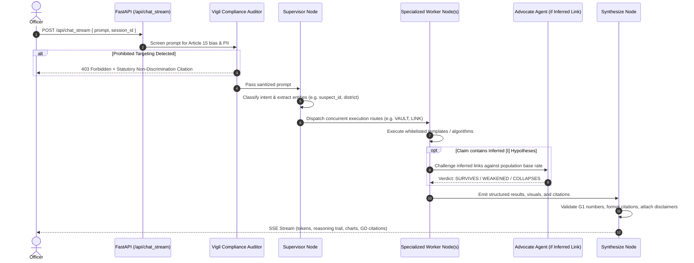

# Antar — Code Modules, Agent Workflows & Pipeline Logic
**Source 3: Ground Truth Code Directory Tree, Execution Graph, and Node Internals**

---

## 1. Codebase Directory Structure & Module Mapping

```
d:\Project\
├── app/
│   ├── agents/
│   │   ├── manifest.py            # Executable manifest parsed from AGENTS.md at import
│   │   ├── graph.py               # Compiled LangGraph StateGraph, forecast_node, synthesize_node
│   │   ├── supervisor.py          # Intent classification & routing node
│   │   ├── query_agent.py         # Vault: T1-T30 whitelisted templates & self-healing ladder
│   │   ├── network_agent.py       # Link: Bipartite graph builder & network metrics
│   │   ├── profile_agent.py       # Motive: Suspect MO profiler & exact SHAP risk scorer
│   │   ├── geo_agent.py           # Lens: Spatial density & police beat suggestions
│   │   ├── prediction_agent.py    # Core: Crime risk forecaster & conformal bands
│   │   ├── pattern_agent.py       # Sense: Modus operandi repeat pattern detector
│   │   ├── alert_suggest_agent.py # Beacon: Patrol redeployment advisor (HITL gated)
│   │   ├── research_agent.py      # Trace: Dossier compiler with K/D/I/U epistemic markers
│   │   ├── advocate_agent.py      # Adversary: Empirical Bayesian base-rate auditor
│   │   ├── social_agent.py        # Sense: Demographic aggregate-only insight (Article 15 safe)
│   │   ├── brain_agent.py         # Vault: Semantic recall from 100k vector index
│   │   └── vigil_agent.py         # Pre-execution statutory compliance & PII scrubber
│   ├── api/
│   │   ├── chat_api.py            # /api/chat and SSE streaming /api/chat_stream
│   │   ├── accuracy_api.py        # /api/accuracy benchmark endpoints
│   │   ├── scale_api.py           # /api/scale benchmark & query execution endpoints
│   │   ├── forecast_api.py        # /api/forecast/league & /explain endpoints
│   │   ├── er_api.py              # /api/schema/er ER fill-rate endpoints
│   │   ├── hitl_api.py            # /api/hitl proposal & approval lifecycle endpoints
│   │   └── auth_api.py            # /api/auth/login and session management
│   ├── core/
│   │   ├── auth_middleware.py     # Token verification & Identity resolution
│   │   ├── hitl.py                # Cryptographic approval ledger (SHA-256 payload hashing)
│   │   └── policy.py              # Role-based access control (Constable, Inspector, Approver)
│   ├── forecast/
│   │   ├── challenger.py          # LightGBM Poisson GBDT with TreeSHAP & conformal bounds
│   │   ├── model.py               # Champion Poisson GLM model
│   │   ├── league.py              # Head-to-head backtest tournament evaluator
│   │   └── backtest.py            # PEI & PAI@5% evaluation metrics
│   ├── second_brain/
│   │   ├── vec_store.py           # PyTorch CUDA fp16 accelerated 100k vector index
│   │   ├── embedder.py            # BGE-Small ONNX embedding wrapper
│   │   └── reranker.py            # MiniLM-L6 cross-encoder reranker
│   └── services/
│       ├── scale_bench.py         # DuckDB vs SQLite 1-Crore row analytical benchmark
│       └── product_store.py       # Compiled intelligence products cache
└── antar-frontend/
    ├── app/                       # Next.js App Router (/login, /demo, /antar, /predict, /scale)
    ├── components/                # React UI components (ChatConsole, Constellation3D, etc.)
    └── lib/                       # Client utilities (auth.js, assets.js, api.js)
```

---

## 2. End-to-End Turn Execution Lifecycle

Every turn submitted by an officer follows a strict, non-divergent execution pipeline:



---

## 3. Detailed Node Internals & Guardrail Logic

### 3.1 Supervisor Node (`app/agents/supervisor.py`)
- **Clear Sentinels:** Clears previous turn outputs (`CLEAR` sentinels on `results`, `visuals`, `citations`, `brain_hits`, `actions`) to prevent state pollution across multi-turn sessions in the LangGraph SQLite checkpointer.
- **Intent Mapping:** Maps raw phrases to canonical routes:
  - `"How many FIRs in Mysuru?"` $\rightarrow$ `VAULT` (Query Agent).
  - `"Who is connected to Ramesh?"` $\rightarrow$ `LINK` (Network Agent).
  - `"What is the motive of suspect 42?"` $\rightarrow$ `MOTIVE` (Profile Agent).
  - `"Forecast crime risk for next week"` $\rightarrow$ `CORE` (Forecast Node).
  - `"Build a background dossier on Suresh"` $\rightarrow$ `TRACE` (Research Node).
- **Confidence Gate:** If intent routing confidence drops below $0.80$, collapses safely to `VAULT` rather than speculating across secondary agents.

---

### 3.2 Query Agent & Self-Healing Ladder (`app/agents/query_agent.py`)
When a query executes, it does not fail silently or throw raw database errors. It climbs an **honest self-healing escalation ladder**:
1. **Tier 1 (Whitelisted Template):** Matches against 26 predefined parameterized queries (`T1–T30`).
2. **Tier 2 (Template Reroute):** If parameter shapes mismatch, dynamically rewrites filters against verified schema indices.
3. **Tier 3 (SQL Miner Relaxation):** Broadens date windows or spatial boundaries if initial search yields 0 rows.
4. **Tier 4 (Dense Semantic Recall):** Falls back to semantic similarity over FIR crime summaries in the Second Brain.
5. **Tier 5 (Hybrid BM25 Fallback):** Executes sparse lexical search over raw General Diary text.
6. **Tier 6 (Honest Dead-End):** If all stages miss, emits an explicit **Honest Dead-End** stating no official FIR match exists, suggesting the nearest valid station or section. **Never fabricates a plausible row.**

---

### 3.3 Synthesize Node & Deterministic Guardrails (`app/agents/graph.py`)
The terminal node in the LangGraph topology enforces strict post-execution invariants:

1. **Single-Agent Fast Path:**
   If only one agent returned data (e.g., standard Query turn), the response is formatted **deterministically without calling an LLM**. This eliminates ~4.9s of synthesis latency and completely prevents LLM drift.
2. **Deterministic Guardrails (G1–G6):**
   - **G1 (Number Grounding):** Extracts all numeric figures from the synthesized answer and asserts that every single digit is present in the raw database query output. Any hallucinated percentage or count causes instant rejection and fallback to deterministic string templates.
   - **G2 (No-Result Honesty):** If the database returned 0 rows, the answer must explicitly state that no record exists. Fabricating a generic summary is blocked.
   - **G3 (Identifier Formatting):** Verifies that FIR numbers adhere to official KSP format (`CrimeNoOfficial: 1{did:04}{uid:04}{yr:04}{serial:05}`).
   - **G4 (Slop Suppression):** Strips conversational filler, apologies, and AI disclaimers (`"Sure! Here is the data..."`, `"I hope this helps!"`).
   - **G6 (Length Enforcement):** Truncates verbose generation to keep field briefings concise and readable on patrol tablets.
   - **`date_guard`:** Blocks any explicit future calendar date in forecasts (e.g. *"Redeploy on November 5, 2026"* $\rightarrow$ transformed to relative risk window *"High activity window: Days +3 to +7"*).
